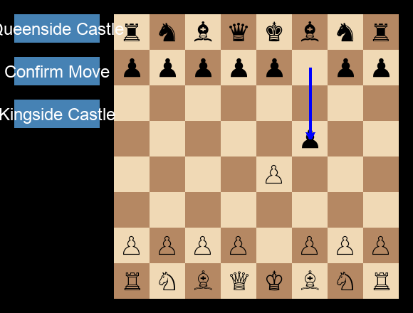

# ZeroStyleChessBot

> **Note: this project was written by hand in 2024, but cleaned up and modernised using coding agents in 2026**

[](https://github.com/domrigby/ZeroStyleChessBot/actions/workflows/ci.yml)
[](LICENSE.md)


An AlphaZero-style chess engine: a ResNet policy/value network guiding Monte-Carlo Tree Search, with move
generation in a custom C++ engine. The network was pre-trained by behavioural cloning on Lichess games, then
fine-tuned with parallel self-play reinforcement learning.

This is a personal project built on consumer hardware (an RTX 1050 for development and an RTX 3090 for training).
It's a working pipeline, not a strong engine: there's no formal strength measurement, and the known limitations
below matter for playing strength. Everything also runs on a CPU-only laptop, slowly.



## Quickstart

Requirements: [uv](https://docs.astral.sh/uv/) and a C++17 compiler (Xcode Command Line Tools on macOS,
`build-essential` on Linux). cmake and ninja are fetched automatically if they aren't installed.

```bash
git clone https://github.com/domrigby/ZeroStyleChessBot.git
cd ZeroStyleChessBot
uv sync                        # creates .venv and compiles the C++ engine (chess_moves) into it
scripts/download_weights.sh    # downloads the pretrained network to neural_nets/example_network.pt
```

**Play against the engine** (opens a pygame window):
```bash
uv run python -m scripts.human_vs_machine
```
Drag a piece to its target square, then press **Confirm Move**. The engine's reply is drawn as a blue arrow. It
searches 2000 MCTS simulations per move: about 7 s on an Apple-silicon laptop CPU, longer on slower machines. Change
that with `num_rollouts=500`, or the weights with `network_path=PATH`. The side panel shows its evaluation, top
candidates (visits, Q, network prior) and expected line; in analysis mode (below) green arrows also show the moves it
is weighing. Hide both with `show_search=false` (also accepted by `engine_vs_engine`). The engine plays its most visited
move; `move_selection=q` makes it play the move with the highest searched value instead.

While you think, the engine keeps searching your position (pondering), so its reply builds on that search; turn this
off with `ponder=false`. Two presets set what the panel shows meanwhile:
```bash
uv run python -m scripts.human_vs_machine --config-name human_vs_machine_play      # the default: no arrows; search statistics, but not your candidate moves
uv run python -m scripts.human_vs_machine --config-name human_vs_machine_analysis  # everything, arrows for your best moves included
```
Both accept the overrides above; `display_mode=analysis` on the default config does the same.

Step back through the game with ←/→ (Home/End for the start and the live position); the panel shows the engine's last
search of the position you are viewing, and the engine keeps searching the live one meanwhile. You can only move on
the live position. Analysis mode adds a graph of White's expected score, (1 + value) / 2, over the game; click it to
jump to a move. `engine_vs_engine` has the same controls, with the graph whenever `show_search` is on.

**Run a short training job on CPU:**
```bash
uv run python -m scripts.parallel_train num_agents=2 sims=32
```
Press Ctrl+C to stop it. It shuts down cleanly and writes a final checkpoint to `sessions/run_at_<timestamp>/`.
The defaults (4 agents, 1000 simulations per move) are meant for a GPU. Logging goes to TensorBoard and to wandb in
offline mode, so no account is needed.

Configuration uses [Hydra](https://hydra.cc) overrides (`key=value`) validated by Pydantic. Every option, with its
default and a description, is in
[`zero_style_chess_engine/config/models.py`](zero_style_chess_engine/config/models.py); the YAML files in
[`conf/`](conf/) only hold Hydra settings. Search constants are nested: `search.c_puct=1.5`. Add `--cfg job` to print the resolved config
without running. To continue a run, point Hydra at its folder:
`uv run python -m scripts.parallel_train hydra.run.dir=sessions/run_at_<timestamp>`.

By default, self-play starts from the standard position and uses no expert data. To use the Lichess puzzle
curriculum or mix in expert games, set `curriculum_csv_path=...` and `expert_data_path=...`. The datasets aren't in
the repo; [`neural_nets/data/data_sources.md`](neural_nets/data/data_sources.md) lists where to get them.

## Architecture

```
        scripts/parallel_train.py (supervisor)
   spawns every process and watches for one dying; Ctrl+C or a crash
   sets the shared stop event, and every process shuts down
   ──────────────────────────────────────────────────────────────────────

  ┌──────────────────┐   positions to evaluate    ┌────────────────────┐
  │ GameTree agent×N │ ─────────────────────────▶ │ Evaluator          │
  │ MCTS self-play,  │   (one queue per agent)    │ batched inference  │
  │ C++ move gen     │ ◀───────────────────────── │ on its own copy of │
  └────────┬─────────┘   priors + values          │ the network        │
           │             (one queue per agent)    └─────────▲──────────┘
           │ finished games                                 │ state dict every
           ▼ (experience queue)                             │ weights_update_freq steps
  ┌──────────────────┐                                      │ (one queue per evaluator,
  │ Trainer          │ ─────────────────────────────────────┘  maxsize 1)
  │ replay buffer,   │
  │ SGD on the net   │
  └──────────────────┘
```

- **Agents** (`zero_style_chess_engine/parallel_game_tree.py`) each play self-play games with MCTS. Instead of
  blocking on the network, an agent sends leaf positions to its evaluator and keeps searching other branches.
- **Evaluators** (`evaluator.py`) collect requests from all their agents into one batch, run a single forward
  pass, and send the priors and values back.
- **The trainer** (`trainer.py`) turns finished games into training data, samples batches from the replay buffer
  (`memory.py`), trains, and pushes new weights to every evaluator.
- **The supervisor** (`scripts/parallel_train.py`) uses the `spawn` start method. Each process checks a shared stop event, so
  shutdown is orderly: trainers first (they do the final save), then evaluators, then agents. The exit code is
  non-zero if any process crashed.

## Design notes

- **Virtual loss.** Each rollout puts a temporary penalty on the move it took, so the next rollouts explore other
  branches while the network evaluation is still in flight. The penalty is removed when the value is
  backpropagated.
- **Batched inference with a maximum lag.** An agent can have up to `maximum_lag` (default 8) evaluations
  outstanding before it waits for results. This keeps the evaluator's batches full without letting the search run
  far ahead on stale statistics.
- **Two sources of self-play data.** Every finished game is saved with its outcome as the value target: +1 for
  positions of the side that delivered mate, -1 for the other side, 0 for a draw. Games stopped at the 300-move
  cap have no outcome and are dropped. The agent also saves the terminal lines its search finds, for as long as
  every move on the line was the best move by Q. This yields extra decisive positions from games that
  weren't played out.
- **Entropy-weighted position sampling.** Only two positions from each game go into the replay buffer,
  sampled in proportion to the entropy of the search policy. Positions where the search was uncertain are kept more
  often. A floor makes the most uncertain position at most about 10× as likely as the least.
- **Expert/self-play mixing.** When expert data is given, each training batch mixes expert positions with self-play
  positions. The expert share starts at 90% and decays by a factor of 0.995 per training step, so pre-training
  knowledge fades out gradually instead of being overwritten at once.
- **Curriculum.** With a Lichess puzzle CSV, the first games start from puzzle positions of increasing difficulty
  (mate-in-2 up to mate-in-5 and "crushing" positions), then switch to the standard starting position.
- **Exploration.** Dirichlet noise is mixed into the root priors during self-play.

## Known limitations

- **Only two positions per game reach the replay buffer.** This keeps the buffer closer to IID, but it throws away
  most positions, including other uncertain ones.
- **The policy loss is per square.** The policy head outputs 70 move types for each of the 64 from-squares. Training
  uses a separate cross-entropy for each square, so the network is never trained to pick *which* piece to move.
  Inference uses one softmax over all legal moves. Switching training to the flattened loss needs a training run to
  validate.
- **The C++ engine doesn't generate castling moves.** The castling flags are parsed but not used. The play window
  has castling buttons for the human side.
- **Capture-promotions share a policy index with straight promotions** (for example, `b2b1q` and `b2a1q`).
- **Changed move mask.** Illegal moves now get a very large negative logit instead of 0. The shipped weights were
  trained with the old mask. On a random network, the new mask gives the same move ranking, but this hasn't been
  checked yet with the real weights.
- **Spawn shares parameter memory.** With `spawn`, PyTorch puts the network's parameters in shared memory, so the
  trainer and evaluators would edit the same weights. Each evaluator therefore gets its own copy, which costs one
  extra copy of the weights per evaluator. This has been verified on CPU only; on CUDA it's expected to behave the
  same but hasn't been tested.

## Development

```bash
uv run pytest -m "not integration"            # unit tests, a few seconds
uv run pytest tests/integration -m "not slow" # multi-process shutdown and fault-injection tests, ~35 s
uv run ruff check . && uv run ruff format --check .
uv run mypy                                   # configured in pyproject.toml
uv run pre-commit install                     # run ruff and mypy on every commit
```

CI runs all of the above on CPU for every push to `main` and every pull request. Editing the C++ source
(`cpp_chess_env/`) or `CMakeLists.txt` makes the next `uv sync` or `uv run` rebuild the engine. If you change a
binding, update `stubs/chess_moves.pyi` by hand.

Other entry points:
- `uv run python -m scripts.supervised_learning data_dir=DIR`: behavioural-cloning pre-training on pickled games.
- `uv run python -m scripts.engine_vs_engine black.engine_path=PATH`: play the network (White) against a UCI engine
  such as Stockfish (Black), capped at `black.elo` (default 1600; `black.elo=null` for full strength, or for engines
  without `UCI_Elo` such as Lc0). Pick either side's player with `player@white=` / `player@black=` `zero_style`,
  `uci`, `heuristic_mcts` or `random`, e.g. checkpoint vs checkpoint: `player@black=zero_style black.network_path=ckpt/step_5000.pt`.
  `heuristic_mcts` is a baseline: the same MCTS with uniform priors and a hand-written value function in place of
  the network, `black.value_function=material` (default; material balance) or `zero` (only game ends score).
  `random` plays a uniformly random legal move: `player@black=random` pits the network against it.

## Future work

- Fix the known limitations above, starting with the policy loss.
- Distil the network into a smaller one for fast play on low-end GPUs.
- League training and distributed multi-GPU training.

## Use of LLMs

I wrote the chess playing reinforcement learning part by hand: distributed MCTS, training, evaluation server etc.

LLMs were used to create a lot of the testing and support scripts (PyGame interface, plotting etc.) and helped **a lot** to build the C++ chess simulator.

## License

This project is licensed under the MIT License. See [LICENSE.md](LICENSE.md) for details.
